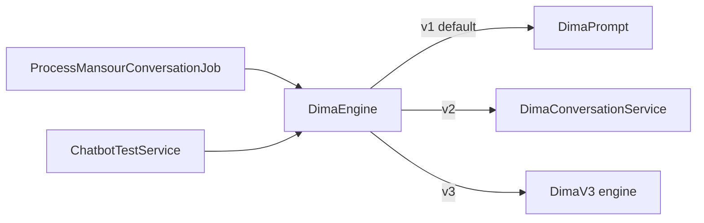
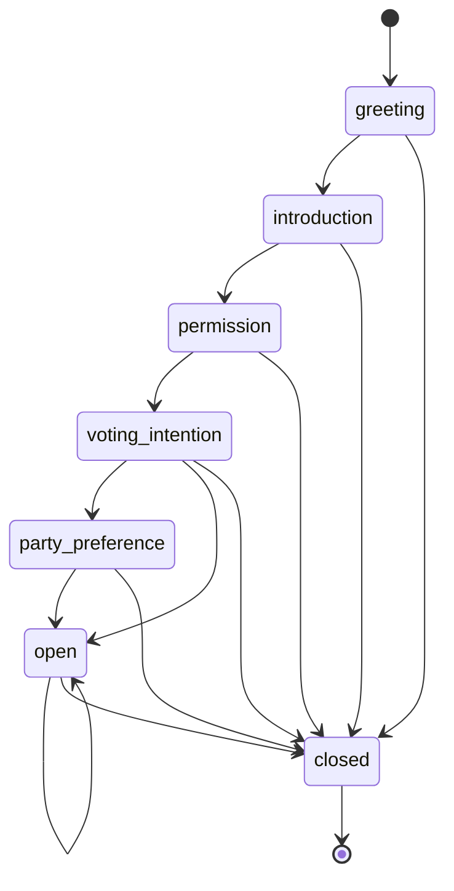
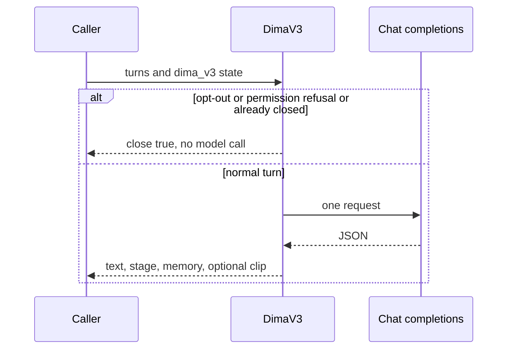

# Dima V3 Conversation Engine - Plan

## Goal Capsule

- **Objective:** A person chatting with Dima on the test path gets a direct reply, can be asked about voting only after a transparent introduction, and can stop the chat, without the bot inventing a fact or swapping in a persuasion script.
- **Means:** A separate V3 engine selected by `DIMA_ENGINE`, reusing delivery and storage (KTD1).
- **Authority:** Product behavior lives on the Requirements. Mechanism lives on the Key Technical Decisions. This plan does not enable live WhatsApp sending and does not call the paid model from tests.
- **Execution:** Code, in this repository. Prove it with mocked multi-turn tests. Do not deploy.
- **Stop:** Stop if V3 requires an edit to `app/Services/AiChatbot/DimaPrompt.php` or `app/Services/AiChatbot/DimaConversationService.php`. Stop if a test would call OpenAI. Stop if `DimaEngine::allowsOutbound()` would be changed to true.

## Product Contract

### Summary

Dima V3 is a separate conversation engine, off unless `DIMA_ENGINE=v3`. It keeps WhatsApp delivery, conversation storage, and the current reply array. It replaces the scripted prompt and regex fallbacks with a stage flow, a small memory record, one model call on a normal turn, and a code-versioned fixture catalog.

### Problem Frame

The current Dima conversation path has been patched with prompt rules and regex fallbacks until a turn is hard to predict. A valid model answer can be replaced by a political script, and the stored memory cannot hold the fields this outreach needs. V1 and V2 stay as they are so the new path can be judged on its own.

### Key Decisions

- Code-versioned video catalog. A clip change ships with the app. (session-settled: user-approved — chosen over records an operator edits without a deploy: confirmed with the scope) Governs R7.
- Fixture catalog only. Existing project videos stay out until someone supplies title, source, date, transcript, and factual context for each one. (session-settled: user-approved — chosen over importing clips already in the project: confirmed with the scope) Governs R7.
- A clear "no" during the permission stage closes the chat. A "no" during the voting stage is a voting answer and leaves the chat open. Governs R4.

### Requirements

#### Engine selection

- R1. `DIMA_ENGINE` unset, `v1`, or `v2` keeps today's engine. V3 runs only when the value is `v3`.

#### Conversation

- R2. Stored stages are `greeting`, `introduction`, `permission`, `voting_intention`, `party_preference`, `open`, and `closed`. An unknown name does not replace the stored stage. `voting_intention` is entered only from `permission`. `party_preference` is entered only from `voting_intention`. The model cannot set `closed`.
- R3. A clear request to stop closes the chat on that turn, before any model call.
- R4. A clear refusal during the permission stage closes the chat before any model call. A negative voting answer does not close the chat.

#### Memory

- R5. The engine stores current stage, permission status, voting intention, party mentioned, last user question, previously answered topics, sent media ids, and opted out.
- R6. Voting intention and party mentioned are stored and are not used to choose a persuasion script or a clip.

#### Media

- R7. The catalog is PHP in the app and starts with test fixtures only. Each fixture has an id, title, source, publication date, transcript, factual context, category, and media URL.
- R8. A clip is attached only when the model names a catalog id, the description of that clip is non-empty, and that id is not already stored. The same id is not attached on a later turn.

#### Model

- R9. A normal turn makes one chat-completions request. Opt-out, permission refusal, and an already closed chat make none. A failed or unreadable response does not trigger a second request.
- R10. When the model returns usable text, that text is the reply. The engine does not replace it with a political script.
- R11. The reply is concise Palestinian Arabic. It answers the latest question, separates a verified catalog fact from a political claim, and does not invent a quotation, crime, statistic, or historical event. It does not end every reply with a question.

#### Contract and logging

- R12. The return value keeps `text`, `stance`, `note`, `close`, `video`, `stage`, `identity`, `memory`, and optional `clips`.
- R13. The raw model output and the final reply are logged after phone-like digit runs are removed. The API key and the full message history are not logged.

### Actors

- A1. The person in the chat.
- A2. The operator who sets `DIMA_ENGINE`.

### Key Flows

- F1. Normal turn
  - **Trigger:** A1 sends a message and the chat is not closed.
  - **Actors:** A1
  - **Steps:** The engine reads V3 state, skips the model only for R3 and R4, otherwise makes one request, keeps usable text (R10), validates any clip (R8), and writes state (R5).
  - **Covered by:** R2, R5, R8, R9, R10, R12
- F2. Stop
  - **Trigger:** A1 asks to stop, or refuses permission.
  - **Actors:** A1
  - **Steps:** The engine marks opted out, sets the stage to closed, returns `close` true, and does not call the model.
  - **Covered by:** R3, R4, R9

### Acceptance Examples

- AE1. Voting no stays open
  - **Covers:** R4, R5, R6
  - **Given:** The stage is `voting_intention`.
  - **When:** A1 answers no.
  - **Then:** Voting intention is stored as no, the chat stays open, and the reply is the model text.
- AE2. Permission no closes
  - **Covers:** R4, R9
  - **Given:** The stage is `permission`.
  - **When:** A1 refuses.
  - **Then:** The chat closes and the model is not called.
- AE3. A clip is sent once
  - **Covers:** R6, R8
  - **Given:** The fixture id has not been sent, and the model names it with a description.
  - **When:** A later turn names that same id.
  - **Then:** The first turn attaches it. The later turn does not, including when the stored party or vote would have selected it under V2.
- AE4. Opt-out
  - **Covers:** R3, R9
  - **Given:** The stage is `open`.
  - **When:** A1 asks to stop.
  - **Then:** The chat closes on that turn and the model is not called.

### Success Criteria

On the test path, one conversation stores a yes vote and a no vote, passes a leadership answer through in the model's words, attaches one fixture clip a single time, and closes when A1 opts out. A greeting-stage reply that asks how the person will vote does not move the stage to `voting_intention`. The test process does not contact OpenAI.

### Scope Boundaries

In scope: the V3 engine, its state record, the fixture catalog, the flag branch, caller delegation for read, remember, opening, and closed checks, and the mocked tests listed in U4.

Out of scope: edits to V1 or V2 conversational classes, individualized persuasion scripts, a second model call, a tool-calling loop, a database catalog, importing videos already in the project, and turning outbound WhatsApp on.

#### Deferred to Follow-Up Work

- Supply real clip metadata and files after an operator provides title, source, date, transcript, and factual context.
- Enable `DimaEngine::allowsOutbound()` in a later change. This plan leaves it false.
- Migrate an in-progress V1 `metadata.dima` record into the V3 record. A chat that starts on V3 begins with empty V3 state.

### Sources

Local code, read for this plan:

- `app/Services/AiChatbot/DimaEngine.php` branches `nextReply` and `nudge` on `config('dima.engine')`. `allowsOutbound()` returns false.
- `config/dima.php` reads `DIMA_ENGINE`, default `v1`. `phpunit.xml` sets `DIMA_ENGINE=v1`.
- `app/Services/AiChatbot/DimaPrompt.php` `remember`, `read`, and `memoryFrom` keep only the V1 memory keys. `normalizeStage` blanks any stage outside the V1 list, and `remember` then stores greeting.
- `app/Jobs/ProcessMansourConversationJob.php` calls `DimaEngine::nextReply`, then `DimaPrompt::remember`. `video` true sends the fixed no-vote file. `clips` send only when the storage path exists.
- `app/Services/AiChatbot/ChatbotTestService.php` seeds `DimaPrompt::openingFor` and calls `DimaPrompt::read` / `remember`.
- `app/Services/AiChatbot/MansourConversationRevival.php` treats a Dima chat as open via `DimaPrompt::isClosed`, then returns immediately when outbound is blocked. An empty nudge is not sent.
- `app/Services/AiChatbot/MansourBotService.php` uses `DimaPrompt::openingFor` for a Dima opening.
- OpenAI on this path is `Http` `post` to chat completions through `MowahadaOpenAi::key`. Tests inject a static responder. Under PHPUnit, a missing responder returns null and does not call the network.
- `docs/solutions/` is absent. No Compound Pack applied.

## Planning Contract

### Key Technical Decisions

- KTD1. V3 is a new namespace under `app/Services/AiChatbot/DimaV3/`. `DimaEngine` is the only branch. V3 state is stored on `ChatbotConversation.metadata.dima_v3`, not through `DimaPrompt::remember`. The job, the test chat, the revival closed-check, and the Dima opening call `DimaEngine` methods that delegate to `DimaPrompt` when the engine is not `v3`. The directive to leave V1 and V2 untouched still holds for `DimaPrompt.php` and `DimaConversationService.php`: those files drop unknown stages and memory keys, so routing around them is the seam that keeps their behavior. Governs R1, R5, R12.
- KTD2. V3 never sets `video` true. The job already sends `id`, `disk`, `path`, and `name` when the file exists. V3 adds `url` and `description` beside those keys. The model puts the clip description in the reply text and in `description`. The engine copies that text through unchanged and does not append the description again. (session-settled: user-approved — chosen over a database catalog and over the existing project clips: confirmed with the scope) Governs R7, R8, R10, R12.
- KTD3. The model returns JSON for reply text, stage, memory fields, and an optional media id plus description. An empty record starts at `greeting`. A proposed stage is kept only when it is a non-close edge from the stored stage: `greeting` to `introduction`, `introduction` to `permission`, `permission` to `voting_intention`, `voting_intention` to `party_preference` or `open`, `party_preference` to `open`, and `open` to `open`. `closed` and opted out are set only on the R3 and R4 paths. An unknown media id is dropped. Media with an empty description is dropped. Unreadable JSON or a transport failure becomes one short non-political line and does not call the model again. Governs R2, R8, R9, R10.
- KTD4. `DimaEngine::nudge` on V3 returns an empty string. Revival already ignores an empty nudge, so V3 does not add a model call or a V1 script. Governs R9, R10.
- KTD5. The system prompt carries the stage list, the stored state, fixture titles with factual context, and the rules in R2, R6, and R11. It tells the model not to ask how the person will vote until `introduction` is stored and permission was granted. The introduction names Dima and مركز اتصالات القائمة العربية الموحدة, and says the purpose is to hear the person's view. That message does not ask the voting question. This is the identity V1 gives when asked who is speaking. V3 does not copy V1's rule that hides that name on the early messages. The model is not given tools. Governs R2, R6, R9, R11.
- KTD6. The V3 log event records conversation id, stage, close, media id, call count, redacted raw output, and redacted final text. Redaction removes a contiguous run of 7 or more digits, and a phone-like number whose digits are split by spaces, dashes, or parentheses, including a leading plus and country code. The API key is not written. The raw JSON is still logged after that redaction, because the request asked for the raw response. Governs R13.

### High-Level Technical Design

V3 sits behind the existing switch. Callers keep passing turns and a prior record in, and keep reading the same reply array out.



The stage list is the conversation flow. Code forces `closed` only for opt-out and permission refusal. Every other move is kept only when it is a non-close edge from the stored stage (KTD3).



One normal turn:



What stays and what is replaced:

| Piece | Decision |
| --- | --- |
| `DimaEngine` branch, job text/clip delivery, test-chat message rows, `metadata` JSON, `MowahadaOpenAi` key, `Http` chat completions, static test responder | Reuse |
| Green API and Whapi send | Reuse, and outbound stays off |
| `DimaPrompt` scripts, regex fallbacks, `memoryFrom` | Leave in place for V1. V3 does not call them |
| `DimaConversationService`, `DimaResponseValidator`, `DimaConversationState` clips, `DimaKnowledge`, `DimaFacts` | Leave in place for V2. V3 does not call them |
| Stage flow, state record, fixture catalog, one-call prompt, redacted log | New, under `DimaV3` |

### Risks & Dependencies

- A caller that still reads `DimaPrompt::read` while the flag is `v3` will see greeting and empty V1 memory. U5 switches the four call sites named in KTD1. Any new caller has to use `DimaEngine`.
- The prompt can tell the model not to invent a fact. It cannot prove the live model obeyed. Tests prove the engine passes usable text through and drops an unknown clip. They do not prove a live model.
- `allowsOutbound()` is false, so the job returns before `nextReply` on live WhatsApp. This plan proves V3 on the engine and the test-chat path.
- A fixture whose file is missing is still returned on the reply array. The job skips a missing storage path and does not send the no-vote video, because `video` stays false (KTD2).

### Output Structure

```text
app/Services/AiChatbot/DimaV3/
  ConversationFlow.php
  ConversationState.php
  MediaLibrary.php
  ConversationEngine.php
  TurnLogger.php
tests/Feature/AiChatbot/DimaV3ConversationTest.php
```

`DimaEngine.php`, `config/dima.php`, `.env.example`, and the four caller files in KTD1 are edits, not new files.

### Sequencing

U1, then U2 and U3, then U4, then U5. U2 and U3 do not depend on each other.

## Implementation Units

### U1. Flag branch

- **Goal:** `DIMA_ENGINE=v3` selects the new engine, and any other value keeps today's branch.
- **Requirements:** R1
- **Dependencies:** None
- **Files:** `app/Services/AiChatbot/DimaEngine.php`, `app/Services/AiChatbot/DimaV3/ConversationEngine.php`, `config/dima.php`, `.env.example`, `tests/Feature/AiChatbot/DimaV3ConversationTest.php`
- **Approach:** Add the `v3` branch in `nextReply` and `nudge` per KTD1 and KTD4. U1 adds a thin engine that `nextReply` can dispatch to. The reply behavior stays in U4. Document `v1`, `v2`, and `v3` in the config comment and `.env.example`. Leave the phpunit env value at `v1`.
- **Patterns to follow:** The existing `usesV2()` check in `DimaEngine`.
- **Test scenarios:**
  - Happy path: with `dima.engine` set to `v3`, `nextReply` and `nudge` dispatch to the V3 class, not `DimaPrompt` or `DimaConversationService`.
  - Edge: with the config unset, `nextReply` still uses V1.
  - Edge: with the config set to `v2`, `nextReply` still uses `DimaConversationService`.
  - Error: `nudge` under `v3` returns an empty string and does not call the test responder.
- **Verification:** The three engine values select three different classes, and the V3 nudge makes no model call.

### U2. V3 state record

- **Goal:** The eight memory fields survive a turn without going through `DimaPrompt::memoryFrom`.
- **Requirements:** R2, R5
- **Dependencies:** U1
- **Files:** `app/Services/AiChatbot/DimaV3/ConversationFlow.php`, `app/Services/AiChatbot/DimaV3/ConversationState.php`, `app/Services/AiChatbot/DimaEngine.php`, `tests/Feature/AiChatbot/DimaV3ConversationTest.php`
- **Approach:** Read and write `metadata.dima_v3` per KTD1. Reject an unknown stage and keep the previous one (R2). `DimaEngine::read`, `remember`, and `isClosed` delegate to `DimaPrompt` when the engine is not `v3`.
- **Patterns to follow:** `DimaPrompt::remember` writes one `metadata` key and saves the conversation. V3 uses a different key.
- **Test scenarios:**
  - Happy path: save all eight fields, reload the conversation, and read the same values back.
  - Edge: an unknown stage string leaves the previous stage in place.
  - Edge: with the engine at `v1`, `DimaEngine::remember` still writes `metadata.dima` and does not create `dima_v3`.
  - Integration: `isClosed` is true when V3 state is opted out, and false for a V1 conversation that is not closed.
- **Verification:** A reloaded conversation returns the eight fields, and a V1 save does not gain a `dima_v3` key.

### U3. Fixture catalog

- **Goal:** One code catalog lists fixture clips and refuses an id that is unknown or already sent.
- **Requirements:** R7, R8
- **Dependencies:** U1
- **Files:** `app/Services/AiChatbot/DimaV3/MediaLibrary.php`, `tests/Feature/AiChatbot/DimaV3ConversationTest.php`
- **Approach:** Ship one fixture whose transcript and factual context are labeled as test material, not a political claim (KTD2). Include a storage path the tests can create, plus the media URL. Do not copy entries from `DimaConversationState`.
- **Patterns to follow:** The clip keys the job already reads: id, disk, path, name. Add url and description beside them.
- **Test scenarios:**
  - Happy path: the fixture exposes every R7 field and a non-empty description.
  - Edge: an unknown id is not attachable.
  - Edge: an id already listed in sent media ids is not attachable.
  - Error: a known id with an empty description is not attachable.
- **Verification:** The fixture is the only catalog entry, and the three rejections return no clip.

### U4. One-call conversation engine

- **Goal:** A turn answers from one mocked model response, stores memory, attaches a clip at most once, and closes without a model call when the person stops.
- **Requirements:** R2, R3, R4, R5, R6, R8, R9, R10, R11, R12, R13
- **Dependencies:** U2, U3
- **Files:** `app/Services/AiChatbot/DimaV3/ConversationEngine.php`, `app/Services/AiChatbot/DimaV3/TurnLogger.php`, `tests/Feature/AiChatbot/DimaV3ConversationTest.php`
- **Approach:** Follow F1 and F2. The test responder is the only model. Inspect the outgoing prompt for R6 and R11 rather than calling the network (KTD3, KTD5, KTD6). `video` stays false.
- **Execution note:** Write the multi-turn cases against the public turn method before filling in the engine, so a script overwrite fails the test.
- **Patterns to follow:** `DimaConversationService` static `$testResponder`, and the PHPUnit guard that returns null when no responder is set.
- **Test scenarios:**
  - Happy path: Arabic yes, then Arabic no, on `voting_intention`. Each turn calls the responder once. Yes and no are stored. No does not set `close`. The reply text equals the responder text. Covers AE1.
  - Happy path: Arabic party name and Hebrew party name are stored on `party_mentioned` across two turns. The attached clip does not change between those names. Covers R6.
  - Happy path: a leadership question and a budget question each return the responder text unchanged, and the prompt tells the model to say when it has no verified figure.
  - Happy path: an evidence request whose responder names the fixture id with a description attaches that clip once and records the id. Covers AE3.
  - Happy path: a distrust message is answered with the responder text, then a topic change stores the new last question and appends the previous topic. The second reply is the second responder text.
  - Happy path: the same user sentence sent twice produces two responder calls, not a repeated script, and the second request includes the earlier reply in the history.
  - Edge: permission-stage refusal sets `close` and makes zero responder calls. Covers AE2.
  - Edge: opt-out phrases in Arabic close from `open` with zero responder calls. Covers AE4.
  - Edge: from `greeting`, a responder payload that names `permission`, `voting_intention`, or `closed`, or that sets opted out, leaves the stage at `greeting`, leaves opted out false, and does not set `close`. The outgoing prompt forbids the voting question until introduction is stored and permission was granted.
  - Edge: the introduction prompt names Dima and مركز اتصالات القائمة العربية الموحدة and does not ask the voting question.
  - Edge: a repeated media id on the next turn does not appear in `clips`.
  - Error: responder returns non-JSON. The reply is a short non-political line, `close` is false, and the responder was called once.
  - Error: responder is unset under PHPUnit. The engine does not throw and does not leave a stray HTTP call.
  - Integration: the logged payload drops a contiguous 7-digit run and the digits of `050-123-4567`, and does not contain a sample API key placed in config.
- **Verification:** Every scenario above passes with the responder call count asserted, and `Http` records no chat-completions request.

### U5. Caller delegation

- **Goal:** Test chat and the job persist V3 state, while V1 and V2 callers keep today's `DimaPrompt` behavior.
- **Requirements:** R1, R3, R12
- **Dependencies:** U4
- **Files:** `app/Jobs/ProcessMansourConversationJob.php`, `app/Services/AiChatbot/ChatbotTestService.php`, `app/Services/AiChatbot/MansourConversationRevival.php`, `app/Services/AiChatbot/MansourBotService.php`, `app/Services/AiChatbot/DimaEngine.php`, `tests/Feature/AiChatbot/DimaV3ConversationTest.php`
- **Approach:** Replace direct `DimaPrompt` read, remember, `isClosed`, and Dima `openingFor` uses with `DimaEngine` methods per KTD1. The V3 opening is one fixed Palestinian Arabic greeting that does not ask how the person votes. Do not change `allowsOutbound()`.
- **Patterns to follow:** The current `match` on bot kind in `MansourBotService` and the Dima branch in the job.
- **Test scenarios:**
  - Happy path: a test-chat turn under `v3` stores `metadata.dima_v3` and returns the responder text as the assistant message.
  - Edge: the first test-chat turn under `v3` stores the V3 greeting, not a line from `DimaPrompt::openingFor`.
  - Edge: opt-out through the test-chat path sets `bot_mode` paused.
  - Integration: with the engine at `v1`, a test-chat remember still writes `metadata.dima` and the opening still comes from `DimaPrompt::openingFor`.
  - Error: revival's closed check reports a V3 opted-out conversation as closed.
- **Verification:** V3 test chat persists `dima_v3` and pauses on opt-out. A V1 test-chat path still uses the V1 opening and the `dima` key.

## Verification Contract

- Run `tests/Feature/AiChatbot/DimaV3ConversationTest.php` with `DIMA_ENGINE` left at the phpunit default of `v1` inside the process, and with the test setting `v3` only in its own cases.
- Run `tests/Feature/AiChatbot/DimaBotTest.php` and `tests/Feature/AiChatbot/DimaV2ConversationTest.php` so the V1 and V2 paths still pass.
- The V3 test asserts the responder call count and that no chat-completions HTTP request was made.
- Do not deploy. Do not run a migrate endpoint. Do not set `allowsOutbound()` to true.

## Definition of Done

- U1 through U5 meet their verification notes.
- `git diff` for `app/Services/AiChatbot/DimaPrompt.php`, `DimaConversationService.php`, `DimaContextBuilder.php`, `DimaConversationState.php`, `DimaKnowledge.php`, `DimaKnowledgeService.php`, `DimaFacts.php`, and `DimaResponseValidator.php` is empty.
- Abandoned experiments are not left in the tree.
- No production upload and no live OpenAI call were made.
